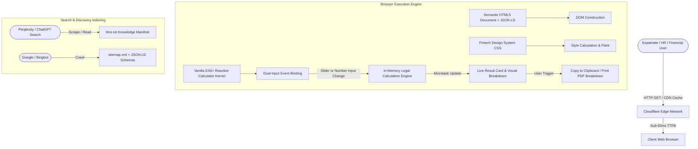

# GulfCalc (gulfcalc.tech) — Technical Architecture Specification

**System Classification:** Ultra-Minimalist, High-Performance Static Web Application  
**Primary Target:** Web Standards (HTML5 / Modern Vanilla CSS / Vanilla ES6+ JavaScript)  
**Host Architecture:** Edge CDN (Cloudflare Pages Static Delivery)

---

## 1. System Architecture & Component Data Flow



---

## 2. Design System Tokens & Aesthetic Foundations

The visual language follows a **Tier-1 European Fintech Aesthetic**: restrained slate tones, razor-sharp 1px structural dividers, generous whitespace, tactile input states, and functional color accents.

### 2.1 CSS Custom Properties (Design Tokens)

```css
:root {
  /* Slate Neutral Palette */
  --color-slate-50:  #f8fafc;
  --color-slate-100: #f1f5f9;
  --color-slate-200: #e2e8f0;
  --color-slate-300: #cbd5e1;
  --color-slate-400: #94a3b8;
  --color-slate-500: #64748b;
  --color-slate-600: #475569;
  --color-slate-700: #334155;
  --color-slate-800: #1e293b;
  --color-slate-900: #0f172a;
  --color-slate-950: #020617;

  /* Accent & Functional Colors */
  --color-emerald-50:  #ecfdf5;
  --color-emerald-600: #059669;
  --color-emerald-700: #047857;
  --color-indigo-50:   #eef2ff;
  --color-indigo-600:  #4f46e5;
  --color-indigo-700:  #4338ca;
  --color-amber-50:    #fffbeb;
  --color-amber-600:   #d97706;

  /* Surface & Border System */
  --bg-primary:   #ffffff;
  --bg-secondary: #f8fafc;
  --bg-tertiary:  #f1f5f9;
  --border-light: #e2e8f0;
  --border-focus: #4f46e5;
  
  /* Typography Scale */
  --font-sans: 'Inter', -apple-system, BlinkMacSystemFont, 'Segoe UI', Roboto, Helvetica, Arial, sans-serif;
  --font-mono: 'JetBrains Mono', ui-monospace, SFMono-Regular, Menlo, Monaco, Consolas, monospace;

  /* Elevation & Shadows */
  --shadow-sm: 0 1px 2px 0 rgb(0 0 0 / 0.05);
  --shadow-card: 0 4px 6px -1px rgb(0 0 0 / 0.05), 0 2px 4px -2px rgb(0 0 0 / 0.05);
  --shadow-hover: 0 10px 15px -3px rgb(0 0 0 / 0.08), 0 4px 6px -4px rgb(0 0 0 / 0.04);

  /* Component Dimensions */
  --touch-target-min: 48px;
  --radius-sm: 6px;
  --radius-md: 10px;
  --radius-lg: 16px;
}
```

---

## 3. Responsive Layout & Viewport Architecture

* **Mobile-First Breakpoint Matrix:**
  * Base: $320\text{px} - 639\text{px}$ (Single-column stacked, touch-optimized, full-width inputs).
  * Tablet: $640\text{px} - 1023\text{px}$ (Refined padding, 2-column benchmark grids).
  * Desktop: $1024\text{px}+$ (Asymmetric 12-column grid: 7-column interactive calculation stage, 5-column sticky result breakdown card).
* **Zero Horizontal Overflow:** Guaranteed via `box-sizing: border-box`, `max-width: 100%`, and container clamping (`clamp(16px, 4vw, 32px)`).
* **Navigation Architecture:**
  * Clean, minimal sticky header ($64\text{px}$ height) with SVG country selector and mobile slide drawer.
  * Structural institutional footer featuring 4 columns: Calculators by Jurisdiction, Statutory Guides, Institutional Compliance, and Copyright/Disclaimer.

---

## 4. Client-Side State & Reactive Computation Kernel

### 4.1 Zero-Dependency Reactivity Model
Calculations are executed synchronously via lightweight DOM listeners (`input`, `change`).
```javascript
// Universal dual-input synchronization pattern
function bindDualInput(sliderEl, numberEl, onUpdate) {
  sliderEl.addEventListener('input', (e) => {
    numberEl.value = e.target.value;
    onUpdate();
  });
  numberEl.addEventListener('input', (e) => {
    sliderEl.value = e.target.value;
    onUpdate();
  });
}
```

### 4.2 Utility Actions
* **One-Click Clipboard Copy:** Formats calculated breakdown into clean plaintext and invokes `navigator.clipboard.writeText()` with accessible visual feedback (`"Copied!"` badge).
* **Executive Print Mode:** Dedicated `@media print` rules strip navigation, ads, and interactive widgets, rendering a pristine, letterhead-style PDF breakdown.

---

## 5. Semantic SVG Flag & Diagram Specification

To maintain sub-second LCP and zero external network requests, all country flags and formula flow diagrams are embedded directly as clean, lightweight inline SVGs:

* **GCC Flag Vectors:**
  1. **United Arab Emirates (UAE):** Red vertical stripe, green, white, black horizontal bars.
  2. **Saudi Arabia (KSA):** Emerald green field, white calligraphy/sword motif.
  3. **Kuwait:** Black trapezoid, green, white, red horizontal bands.
  4. **Qatar:** Maroon with white serrated edge (9 points).
  5. **Oman:** White, red, green horizontal bands, red vertical stripe with national emblem.
  6. **Bahrain:** Red with white serrated edge (5 points).
* **Formula Diagram Vectors:** Concise, mathematical step-by-step vector graphics illustrating the tenure tiers and statutory multiplication nodes.

---

## 6. Comprehensive JSON-LD Schema Architecture

Every tool route embeds a multi-entity JSON-LD `<script type="application/ld+json">`:

```json
{
  "@context": "https://schema.org",
  "@graph": [
    {
      "@type": "WebApplication",
      "@id": "https://gulfcalc.tech/tools/kuwait-indemnity-calculator.html#app",
      "name": "Kuwait Indemnity & Gratuity Calculator (Labour Law Article 55)",
      "applicationCategory": "FinanceApplication",
      "operatingSystem": "All",
      "browserRequirements": "Requires JavaScript. Requires HTML5.",
      "offers": {
        "@type": "Offer",
        "price": "0.00",
        "priceCurrency": "KWD"
      }
    },
    {
      "@type": "BreadcrumbList",
      "itemListElement": [
        {
          "@type": "ListItem",
          "position": 1,
          "name": "GulfCalc Home",
          "item": "https://gulfcalc.tech/"
        },
        {
          "@type": "ListItem",
          "position": 2,
          "name": "Kuwait Indemnity Calculator",
          "item": "https://gulfcalc.tech/tools/kuwait-indemnity-calculator.html"
        }
      ]
    },
    {
      "@type": "FAQPage",
      "mainEntity": [
        {
          "@type": "Question",
          "name": "Why does Kuwait use 26 days instead of 30 days to calculate daily wage?",
          "acceptedAnswer": {
            "@type": "Answer",
            "text": "Under Article 55 of Kuwait Labour Law No. 6/2010, the daily wage for monthly paid workers is determined by dividing monthly remuneration by 26 working days (excluding statutory weekly rest days)."
          }
        }
      ]
    }
  ]
}
```

---

## 7. Performance & Security Safeguards

| Metric / Requirement | Target Budget | Implementation Method |
| :--- | :--- | :--- |
| **First Contentful Paint (FCP)** | $< 0.4\text{s}$ | Zero external font delays, inlined critical CSS tokens. |
| **Largest Contentful Paint (LCP)** | $< 0.8\text{s}$ | Inline semantic SVG icons, no heavy hero images or remote video files. |
| **Cumulative Layout Shift (CLS)** | `0.000` | Hardcoded aspect ratios and fixed container dimensions. |
| **Interaction to Next Paint (INP)** | $< 25\text{ms}$ | Synchronous client calculations with zero DOM thrashing. |
| **Data Privacy (Zero PII)** | $100\%$ Client-Side | Zero transmission of salary, tenure, or user inputs to any server. |
| **Content Security Policy (CSP)** | Tier-1 Strict | Compatible with `default-src 'self'`. |
